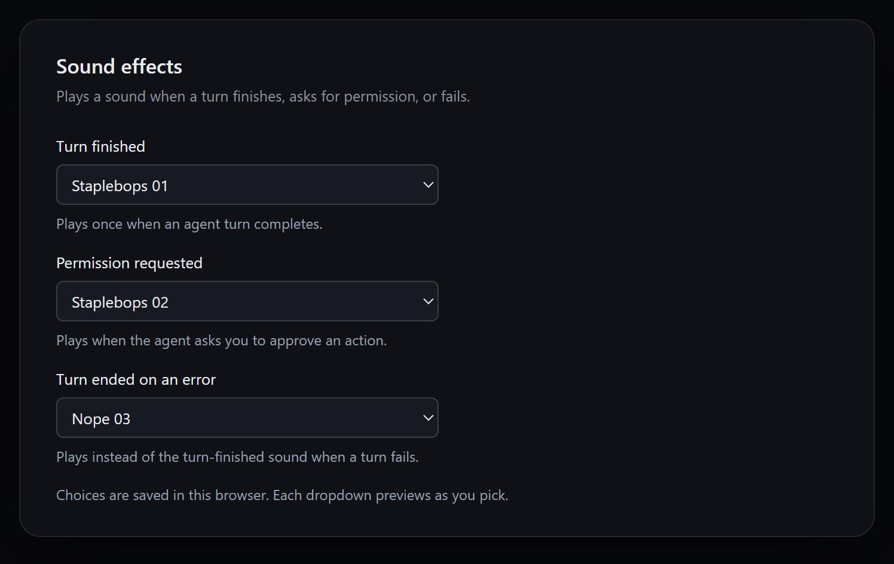

# dsh-occlick

**Plays OpenCode notification sounds in [DeepSeek Harness](https://github.com/deepseek-ai/deepseek-harness)** — one clip when a turn finishes, one when the agent asks for permission, and one when a turn fails, each with its own picker from the whole OpenCode sound library.

[](https://github.com/deepseek-ai/deepseek-harness)
[](LICENSE)
[](#category)
[](https://github.com/topics/dsh-plugin)

OpenCode ships a small library of notification clips for its desktop app. This plugin brings that library to DSH and plays one when a turn finishes, when the agent asks for permission, and when a turn fails, so you can look away while a long task runs and hear when the agent needs you.



*Settings → Sound effects: one picker per event, all 45 OpenCode clips, plus **Off (silent)**. Choosing a clip auditions it immediately.*

## What it does

| Event | Source | Behaviour |
| --- | --- | --- |
| Turn finished | Session `running: true → false` | Plays the turn clip once |
| Permission requested | `approval/request` | Plays the permission clip, then passes the request to the approval UI |
| Turn ended on an error | `api-session/error` | Plays the error clip; the following turn end stays silent |
| User stops the turn | Stop button or `Esc` `Esc` | Silent; a stopped turn did not finish |
| Flicker at boot or reconnect | `true → false` within ~250 ms | Silent |
| A run already going at page load | `running: true` on the first snapshot | Sounds only after ~2 s of observed running |
| Repeated idle refresh | `false → false` | Silent |
| Subagent Session | `origin: subagent` | Silent |
| Mounted over an idle list | — | Silent (no history replay) |

- **Three channels, three pickers**: turn finished, permission requested, and turn ended on an error each choose their own clip.
- **One click per event**: sounds follow the event, not every step, tool call, or streamed token. A failed turn plays the error clip instead of the turn-finished clip, never both.
- **45 sounds each**: everything OpenCode ships — Alert, Bip-bop, Nope, Staplebops, and Yup — with an instant preview as you choose.
- **Configured in DSH**: the same pickers appear on **Settings → Sound effects** and on the plugin's own row under **Plugins**, so they follow the normal enable/disable and uninstall flow.
- **Quiet where it should be**: subagent turns stay silent, a stopped turn stays silent, a burst of approval requests plays once, and opening or reloading the harness cannot replay an old turn end.

Because DSH publishes running state per Session, a turn that ends while you are looking elsewhere still makes the sound. An error is remembered per Session for 15 seconds, so the failed turn does not also play the turn-finished clip. Approval requests are coalesced within 1.5 seconds, so a burst sounds once.

## Install

Requires **DSH 0.2.0 or later** and the Web client (the desktop app, or `dsh web`). The plugin is a Cordis client bundle; it needs a page to render settings into and an audio output.

### From the Plugins page

1. Open **Plugins → Add plugin**.
2. Paste the repository address:

   ```text
   https://github.com/contraliz/dsh-occlick
   ```

3. Click **Install**, then **Enable now**.
4. Open **Settings → Sound effects** and pick a clip.

### From the command line

Copy one line, using the profile that matches how you run DSH:

| How you run DSH | Profile | Command |
| --- | --- | --- |
| Desktop app | `desktop` | `dsh plugin --profile desktop add "git+https://github.com/contraliz/dsh-occlick.git"` |
| `dsh web` | `web` | `dsh plugin --profile web add "git+https://github.com/contraliz/dsh-occlick.git"` |

Restart DSH after a command-line install: bundle entries are composed at startup. To uninstall, use the same command with `remove dsh-occlick`.

### From a checkout

```sh
git clone https://github.com/contraliz/dsh-occlick
cd dsh-occlick
dsh plugin --profile web add .
```

## Choose the sounds

Open **Settings → Sound effects**, or **Plugins → dsh-occlick → Configure**. Both show the same three selectors, each listing every clip and labelled the way OpenCode labels them.

Every channel also offers **Off (silent)**, so one event can be muted while the others keep sounding.

The defaults are the clips OpenCode's own desktop app uses for the same events:

| Channel | Default | OpenCode equivalent |
| --- | --- | --- |
| Turn finished | `staplebops-01` | Agent complete |
| Permission requested | `staplebops-02` | Permission required |
| Turn ended on an error | `nope-03` | Error |

Choosing a sound saves it and plays it immediately, so you can audition without waiting for an event.

| Family | Count | Library names |
| --- | --- | --- |
| Alert | 10 | `alert-01` … `alert-10` |
| Bip-bop | 10 | `bip-bop-01` … `bip-bop-10` |
| Nope | 12 | `nope-01` … `nope-12` |
| Staplebops | 7 | `staplebops-01` … `staplebops-07` |
| Yup | 6 | `yup-01` … `yup-06` |

The choices are stored in the browser under `dsh-occlick.turn`, `dsh-occlick.permission`, and `dsh-occlick.error`, so they are per browser rather than per profile. A turn sound saved by version `0.2.x` (`dsh-occlick.sound`) is carried over. Clearing site data restores the defaults.

## Category

**Integrations & Connections** — the plugin turns DSH's existing turn, approval, and error signals into a local notification channel. It connects no external service, adds no model, tool, or skill, and changes no conversation content.

Suggested tags: `notifications`, `sound`, `audio`, `accessibility`, `opencode`.

## Permissions and risk

`dsh-occlick` is a client-side Cordis bundle with an empty host half. It requests no DSH permission, no tool, no shell command, no filesystem path, and no credential.

| Surface | What the plugin does |
| --- | --- |
| Client services | Reads `sessions.list` (the `running` bit) and registers three slot entries (`settings.section`, `plugins.row.config`, and a pass-through `conversation.composer` selector) plus its locale dictionary |
| Remote events | Observes `approval/request` (then calls the next handler, so the approval UI still wins) and `api-session/error` |
| Browser storage | Reads and writes only the `dsh-occlick.*` keys listed above |
| Network | **None at runtime** — the clips are embedded in the bundle and no request is made |
| Audio | Plays one reused `HTMLAudioElement` from local `data:` URIs |
| Files, shell, MCP, subagents | None |

- **Autoplay, silently**: browsers want a user gesture before audio, so the first pointer press or key press pre-warms that element with a zero-length silent clip. The warm-up is muted and never audible; clicking around the window cannot play a sound on its own.
- **Your stop is not a finish**: stopping a turn with the composer's stop button, or with the `Esc` `Esc` shortcut, keeps the turn-finished sound quiet.
- **Nothing leaves the machine**: no analytics, no telemetry, no remote logging.

## Compatibility

| Requirement | Notes |
| --- | --- |
| DSH **0.2.0+** | Uses client slots, `sessions.list`, `remote.$on`, and `ctx.locale`; the package declares `engines.dsh` |
| Web client | Desktop app or `dsh web`. Headless/TUI profiles have no settings page and no audio output, so the plugin is inert there |
| Chromium/Electron WebView | Needs `HTMLAudioElement`, `localStorage`, and CSS custom properties |
| Node.js 22+ | Development only (build and tests); the installed plugin does not run Node |
| Browser storage enabled | Choices fall back to defaults when storage is blocked |

Tested on the DSH desktop app 0.2.1 on Windows 11. If the pickers do not appear on another DSH version, the client slot API changed; please open an issue with the DSH version.

## Troubleshooting

- **No sound before the first click**: the browser blocks audio until the window has received a gesture. Click or type once; later turn ends play normally, and the click itself is silent.
- **One channel is quiet**: check that its picker is not set to **Off (silent)**.
- **Everything is quiet**: check the system/browser volume and that DSH's window is not muted in the OS mixer.
- **The old sound played when you clicked**: versions ≤ `0.4.0` had an audible warm-up; update to `0.4.1` or later.
- **Choices reset**: clearing site data or using a different browser removes the saved keys.

## Details

- **Bundle, not a patch**: the package ships `cordis.patch.yml`, so DSH lists it under Plugins with its row and a Configure page rather than as a loose Loader row.
- **Audio, not notifications**: the plugin plays a clip through one reused `HTMLAudioElement`. It opens no system notification, registers no service, and adds no toolbar button.
- **One sound per event**: falling edges are guarded per Session, the error marker suppresses the turn sound for that turn, and stop events suppress the turn sound entirely.
- **No host work**: `lib/index.js` exports an empty `apply`, so the server half loads nothing and keeps no state.

## Development

```sh
npm run fetch:sounds   # download the OpenCode clips into assets/audio (needs network)
npm run build          # regenerate lib/client.js from src/client.js + assets/audio
npm test               # offline checks for the generated bundle
```

`lib/client.js` is generated and committed, because DSH serves exactly one script per plugin row: every clip is embedded in it as a data URI. Edit `src/client.js` and rebuild; do not edit `lib/client.js`.

The source layout:

| Path | Role |
| --- | --- |
| `src/client.js` | Browser half: event detection, playback, and the settings pickers |
| `lib/client.js` | Generated browser bundle (committed so the package loads as installed) |
| `lib/index.js` | Host half: an empty `apply` that gives the Loader a row |
| `assets/audio` | The OpenCode clips, as downloaded |
| `scripts/build.mjs` | Embeds `assets/audio` into `lib/client.js` |
| `scripts/fetch-sounds.mjs` | Maintainer tool that refreshes `assets/audio` from OpenCode |
| `test/client.test.mjs` | Offline checks for the generated bundle |

## Credits

The sound library comes from the [OpenCode](https://github.com/anomalyco/opencode) desktop app (`packages/ui/src/assets/audio`) and is MIT-licensed. See [THIRD_PARTY_NOTICES.md](THIRD_PARTY_NOTICES.md).

## License

MIT. See [LICENSE](LICENSE).
